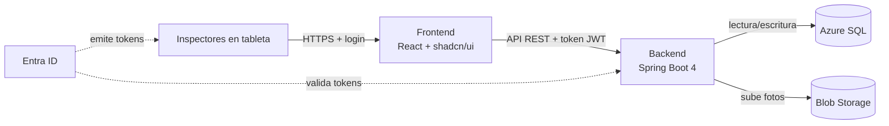

<div align="center">

# Inspección de Campo

**App de inspecciones para equipos de seguridad e instalaciones — tabletas sobre terreno, cero papel.**

[](https://openjdk.org/)
[](https://spring.io/projects/spring-boot)
[](https://react.dev/)
[](https://www.typescriptlang.org/)
[](https://pnpm.io/)
[](https://azure.microsoft.com/)
[](https://www.docker.com/)
[](https://playwright.dev/)

*Parte del taller **Taller de Azure EA · 2026-II — Azure Bootcamp***

</div>

---

## ¿De qué trata?

Una **aplicación de inspección de campo**: un equipo de seguridad o de instalaciones completa, desde una tableta y en el terreno, listas de comprobación, fotos, ubicación, notas y envío de hallazgos.

**Valor de negocio:**

| Beneficio |
|---|
| Informe de inspección más rápido |
| Menos formularios de papel |
| Mejor documentación (fotos y ubicación adjuntas) |
| Acción correctiva más rápida |

> Construcción con **Java + React** sobre **Azure**.

---

## Servicios de Azure

| Servicio | ¿Para qué lo usamos? | ¿Por qué? |
|---|---|---|
| **Azure SQL Database** | Guarda todo lo estructurado: sitios, plantillas de checklist, inspecciones, respuestas | Base de datos gestionada, sin pagar por mantener servidores de BD |
| **Entra ID (antes Azure AD)** | Login de los inspectores y control de quién puede usar la API | No gestionamos contraseñas: la organización ya controla las cuentas |
| **Blob Storage** | Guarda las fotos que suben los inspectores | Los archivos van mejor aparte que la BD; escala a millón de fotos |
| **App Service** | Publica los contenedores del backend y del frontend | Lleva el app a internet sin servidores ni pipelines propios |
| **Container Registry** | Guarda las imágenes Docker que App Service consume | Casa central de las versiones de la app listas para desplegar |
| **Az CLI / azd** | Creó recursos, storage, webapps y así completó su despliegue | Automatización reproducible desde el terminal |

---

## Arquitectura



---

## Tecnologías (versión no técnica)

- **Java** — el idioma en que está escrito el servidor de la app
- **Spring Boot** — el marco que alivia escribir ese servidor
- **React + TypeScript** — la interfaz de la tableta; hecha con componentes listos (shadcn/ui)
- **pnpm** — el instalador de paquetes del frontend
- **Playwright** — testea solos la navegación como un inspector lo haría
- **Docker** — empaca todo en cajas iguales para probar y publicar

---

## Cómo levantarlo

### Prerrequisitos

- Java 21 · Docker Desktop · [Node 24 + pnpm](https://pnpm.io/installation) · suscripción de Azure (solo para publicar)

### Backend

```bash
cd backend
./mvnw spring-boot:run   # lee las variables de entorno del archivo local/.env
```

### Frontend

```bash
cd frontend
pnpm install
cp .env.example .env     # rellena las claves de Entra ID de tu app registration
pnpm dev
```

### Todo junto (contenedor de prueba)

```bash
docker compose up -d
# app: http://localhost:8080 · API: http://localhost:8080/api
```

---

## Variables de entorno

Las que pide la app:

| Backend | Frontend |
|---|---|
| `DB_URL`, `DB_USER`, `DB_PASSWORD` | `VITE_MSAL_CLIENT_ID` |
| `TENANT_ID`, `CLIENT_ID`, `CLIENT_SECRET` | `VITE_MSAL_TENANT_ID` |
| `AZURE_STORAGE_CONNECTION_STRING`, `AZURE_STORAGE_ACCOUNT_NAME` | `VITE_API_CLIENT_ID`, `VITE_API_SCOPE` |
| `AZURE_STORAGE_CONTAINER_NAME` | `VITE_API_URL`, `VITE_REDIRECT_URI` |

---

## Tests

```bash
cd frontend && pnpm exec playwright test   # navegación inspección completa
cd backend && ./mvnw compile               # compilación correcta
```

## Estructura

```
├── backend/    # API REST en Java (Spring Boot 4)
├── frontend/   # SPA para tabletas (React + TS + shadcn)
└── docker-compose.yml
```

## Seguridad

- Los secretos viven solo en `.env` y en las *App Settings* de Azure

---

<div align="center">

**Lasa-lasagna** · Taller de Azure EA · 2026-II · Azure Bootcamp

</div>
